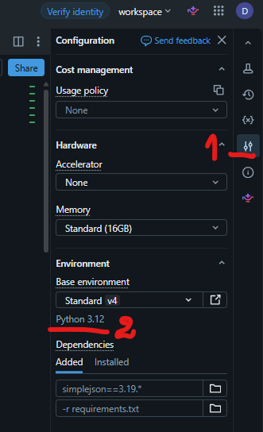
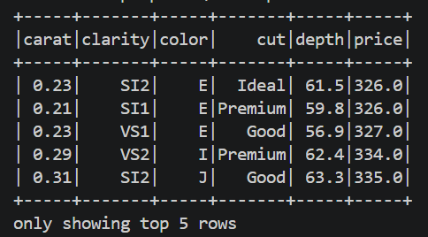

# Section 10 Spark On Your Laptop UDE Notes

## Content
49. [Setup your Laptop for Spark Development](#49-setup-your-laptop-for-spark-development)
50. [Developing Spark Application in the IDE](#50-developing-spark-application-in-the-ide)
51. [Spark Content - Remote Cluster Connection from Your IDE](#51-spark-content---remote-cluster-connection-from-your-ide)


filename.py

```python


```

Run the file
    terminal --> python filename.py

Result:


<br>
<br>


## 49. Set up your Laptop for Spark Development

[⬆ Back to content](#content)

### Requirements for Spark 4.01

Install all requirements below to be able to work with Apache spark locally:

1. JDK 17/21
2. Python 3.10+
   - Python 3.11 for Windows. 
     - Check for the current supported python by spark. Lower version is more secure and avoid unexpecte errors.
     - Make sure that Python is added to system environment PATH
3. Spark Binaries 
   - https://spark.apache.org/downloads.html 
     - Choose a Spark release: choose one version older version for example (4.0.1), so no open bugs can be active
     - Choose a package type: Pre-built for Apache Hadop 3.4 and later
     - Download Spark: spark-4.0.1-bin-hadoop3.tgz - click on the file
   - Link with the exact version should appear. Click and download the file - We suggest the following location for your download: Link
   - Unzip the file and rename it to shorter name like 'spark-4'
   - Move spark-4 directory not deep in structure on your PC, but in more simple path like C:\spark\spark-401. Long directory paths may cause errors.
  
4. Hadoop WinUtils
   - https://github.com/cdarlint/winutils - we must find the hadoop version utils we downloaded spark for - Hadop 3.4 in this case or the latest possible like hadoop-3.3.6/bin
   - download it as ZIP and unzip it. Copy the latest or most close version folder from the unzipped versions and move it into the C:\spark directory but not in spark-401 folder. Rename the hadoop utils folder to 'winutils'.

5. Environment Variables
   - SPARK_HOME
     - go to user environment variables and create new variable: variable name: SPARK_HOME variable value: C:\spark\spark-401
     - edit path user nevironment variable and set new '%SPARK_HOME%\bin'
     - OK/OK to save the changes
  
   - HADOOP_HOME
     - go to user environment variables and create new variable: variable name: HADOOP_HOME variable value: C:\spark\winutils
     - edit path user nevironment variable and set new '%HADOOP_HOME%\bin'
     - OK/OK to save the changes
  
   - PYSPARK_PYTHON - location of Python Spark will use
     - Check where is python installed: terminal --> where is python : C:\Users\<user_name>\AppData\Local\Programs\Python\Python311\python.exe
     - go to user environment variables and create new variable: variable name: PYSPARK_PYTHON variable value: C:\Users\<user_name>\AppData\Local\Programs\Python\Python311\python.exe
     - OK/OK to save the changes

   - PYTHONPATH - C:\spark\spark-401\python:C:\spark\spark-401\python\lib\py4j-x.xx.x.x-src.zip
     - go to user environment variables and create new variable: variable name: PYTHONPATH variable value: C:\spark\spark-401\python:C:\spark\spark-401\python\lib\py4j-x.xx.x.x-src.zip
     - OK/OK to save the changes

Check if Pyspark can run on the PC
    terminal --> pyspark
    This should start a spark session on your PC

    Check the version
    terminal --> spark.version
    '4.0.1'

    Exit the session
    terminal --> exit()

Now we are conffident that spark will work in our IDE

6. IDE

[⬆ Back to content](#content)


## 50. Developing Spark Application in the IDE

[⬆ Back to content](#content)

Configure IDE to work with Spark

Requirements:

Create a Spark Application as the following   
1. Reads data from a survey.csv datafile    
2. Computes the analysis results as shown below   

Country       |      count    
United States |         4   
Canada        |         2   
United Kindom |         1   

Looks like what we want to do is read data from this survey.csv file, create a data frame and perform a group by count analysis on that data frame. And then print that result or produce that result.

Before we start trying to do this, let's try to understand some basic complications or problems while working on your local machine. In this case we will use Python 3.11 for Windows.

Problem:
- Developing on local machine
- Deploy on cluster

1. Spark session (Local/Cluster)    
So the first problem is is Spark session for local machine is different and is Spark session for the cluster is different. So how do we handle that?
While developing our application and testing it on my laptop, I should be creating a local Spark session and when we go and deploy our application on the cluster, we should be creating a Spark session for the cluster.
Solution: It's just a variable. If you are doing it on local, variable value is 'local'. If you're doing it on the cluster, the variable value will be 'cluster'.

2. Data File Source (Local/Cluster)   
Which data file to read and what is the location of the data file is another variable that we have to manage.
One small consideration here is that on the cluster you might have the actual data file, which is huge, which could be huge. But locally we need only small data file for development.

### Development checks    
First sanity check - Make sure to choose the same Python version which you have configured with the Spark Home on your local machine.   
Second sanity check - make sure taht 'pyspark' package is installed included in the pyspark-home package.

### The Development   
1. We must prepare the project folder - HelloSpark in the current session   
2. We want to do two things, load the data, create a data frame, and then perform the analysis, desired analysis to produce the result. Only two things.    

Create utils.py

```python
## import required requirements
from pyspark.sql import SparkSession

## Solve the Spark Session problem - local/cluster variable
def get_spark_session(env: str):
    if env == "local":
        return (
            SparkSession.builder
                # create only 2 threats only for local development
                .master("local[2]")
                .getOrCreate()
        )
    else:
        # create threats allocated by the cluster
        return SparkSession.builder.getOrCreate()

## Read data
def load_survey_df(spark, data_file):
    # simpel file sample for the example
    file_schema = """Timestamp TIMESTAMP,Age INT,Gender STRING,Country STRING,state STRING,self_employed STRING,
                family_history STRING,treatment STRING,work_interfere STRING,no_employees STRING,remote_work STRING,
                tech_company STRING,benefits STRING,care_options STRING,wellness_program STRING,seek_help STRING,anonymity STRING,
                leave STRING,mental_health_consequence STRING,phys_health_consequence STRING,coworkers STRING,
                supervisor STRING,mental_health_interview STRING,phys_health_interview STRING,mental_vs_physical STRING,
                obs_consequence STRING,comments STRING"""
    # return dataframe
    return (spark.read.format("csv")
            .option("header", "true")
            .schema(file_schema)
            .load(data_file)
        )

## Count countries
def count_by_country(survey_df):
    # filter the load_survey_df result
    return(
        survey_df.filter("Age < 40")
        .groupBy("Country")
        .count()
    )
```


Create HellowSpark.py

```python
# import reqired libraries
import sys
from lib.utils import *

if __name__ == "__main__":
    # if there are agument different than 3, exit with error
    if len(sys.argv) != 3:
        print("Usage: HelloSpark {local, qa, prod} file_path: Arguments are missing")
        sys.exit(-1)
    # create spark session with env name
    spark = get_spark_session(sys.argv[1])
    # load file path
    file_path = sys.argv[2]
    # Call the functions with the required arguments
    survey_df = load_survey_df(spark, file_path)
    result_df = count_by_country(survey_df)
    # show the result, show() is used in local environment
    result_df.show()
```

Run the file and check the result. it should be the same as in the requirements.


Create a local unit testing file test_hello_spark.py

```python
# import libraries
import pytest
from lib.utils import *
from pyspark.testing.utils import assertDataFrameEqual

@pytest.fixture(scope="session")
def spark():
    # Global Spark Session passed as fixture
    return get_spark_session("local")

@pytest.fixture(scope="session")
def survey_file():
    return "data/sample.csv"

def test_load_survey_df(spark, survey_file):
    # Actual Result
    expected_rows_count = load_survey_df(spark, survey_file).count()
    assert expected_rows_count == 9

def test_count_by_country(spark, survey_file):
    # Expected Results
    data_list = [("United States", 4), ("Canada", 2), ("United Kingdom", 1)]
    data_schema = "Country string, count long"
    expected_df = spark.createDataFrame(data_list, data_schema)

    #Actual Results
    raw_df = load_survey_df(spark, survey_file)
    actual_df = count_by_country(raw_df)

    # Assert
    assertDataFrameEqual(expected_df, actual_df)
```


[⬆ Back to content](#content)


## 51. Spark Content - Remote Cluster Connection from Your IDE

[⬆ Back to content](#content)

Spark on local machine

1. JDK 17/21
2. Python 3.10+
   - Python 3.11 for Windows
3. Spark Binaries
4. Hadoop WinUtils
5. Environment Variables
   - SPARK_HOME
   - HADOOP_HOME
   - PYSPARK_PYTHON
   - PYTHONPATH
6. IDE

Challanges:
1. Setup local Spark configuration
2. Local environment lack the additional functionalities production platforms are providing
   - The solution - Spark Connect - test the local developed solution on the production environemnt
   - Using Spark Connect simplify local development requirements just to
     1. JDK 17/21
     2. Python 3.10+
     3. IDE

In this section we will lear how to use Spark Connect and develop local Spark applications. 

1. Create local Spark project with python 3.12 local virtual environment        
2. Check what version is supported on the Databricks serverless cluster     
   1. Open any notebook and open the environment tab from the right menu        


<br>
<br>

   2. We can check other environment specifics in the Data Bricks documentation for the specific envronment version here - https://docs.databricks.com/aws/en/release-notes/serverless/environment-version/four     
   - in the time of this course the platform support:       
     - Python 3.12      
     - Databricks Connect: 17       

For more easilly virtual environment management we can use miniconda:

**MINICONDA**

   1. Install MiniConda     
    - Download MiniConda - https://www.anaconda.com/download/success        
      - Install for current user only       
      - Check if miniconda is installed properly        
      - Anaconda PS Terminal ⇾ conda --version      
        Example Result: conda 26.4.0        
      - Change your current environment back to the default one       
        - Anaconda PS Terminal ⇾ conda activate       

   2. Update MiniConda      
    - Anaconda PS Terminal ⇾ conda update conda     

   3. Check current version     
    - Anaconda PS Terminal ⇾ conda --version        
    - Example Result: conda 26.4.0      
  
   4. Manage environments       
    - Open Anaconda PowerShell Prompt terminal    
    4.1. Create new envronment     
      - Anaconda PS Terminal ⇾ conda create --name pyspark-dev     
    4.2. List Environmens      
      - Anaconda PS Terminal ⇾ conda info --envs        
    4.3. Activate specific environment     
      - Anaconda PS Terminal ⇾ conda activate pyspark-dev       
    4.4. Install packages/libraries in conda environment via activated environment     
      - Anaconda PS Terminal ⇾ conda install python=3.12        
      - Anaconda PS Terminal ⇾ python -m pip install "databricks-connect==17.3.*"       

3. Create a small project with spark session using spac connect (databricks connect)

- Find Databricks host        
Host we can find when we log in on Databricks and go to Home page. Copy the address from the browser page and exclude the parameters. Example - host - https://xxx-xxxxxxxx-xxxx.cloud.databricks.com/

- Create Databricks Token       
Go to Databricks platform/ Profile / Settings / Developer / Acces Token / Generate new token    
  - Name: databricks_local_dev_token     
  - Lifetime (days): 180        
  - Auto-scope tokens: On
  - Generate

Create .env file and include it to .gitignore

.env

```txt      
host = "https://xxx-xxxxxxxx-xxxx.cloud.databricks.com/"        
token = "xxxxxxxxxxxxxxxxxxxxxxxxxxxxxxxxxxxx"      
```

Create small file to connect to Databricks:

HelloSparkConnect.py

```python
# import required libraries to create a spark session
from pathlib import Path
from databricks.connect import DatabricksSession
from dotenv import load_dotenv
import os

# load .env file
load_dotenv(Path(__file__).with_name(".env"))

# set variables for host and token for databricks connection
# host = "https://xxx-xxxxxxxx-xxxx.cloud.databricks.com/"
# token = "xxxxxxxxxxxxxxxxxxxxxxxxxxxxxxxxxxxx"
host = os.getenv("host")
token = os.getenv("token")
# cluster_id = os.getenv("CLUSTER_ID")

# builder - set the connection to Databricks cluster
spark = (
    DatabricksSession.builder
        .host(host)
        .token(token)
        # .clusterId(cluster_id)    # connect to specific cluster (not included in the free tier)
        .serverless()
        .getOrCreate()
)

# create dataframe from exisiting table 'diamonds'
df = spark.read.table("dev.spark_db.diamonds")
# show 5 records fomr the created dataframe
df.show(5)
```

Run the file:       
terminal --> conda run -n pyspark-dev python /path/to/HelloSparkConnect.py

Result:


<br>
<br>


[⬆ Back to content](#content)


