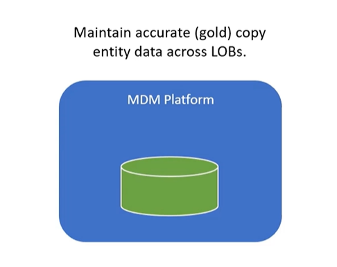
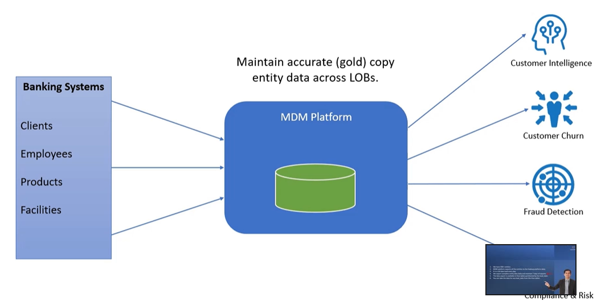
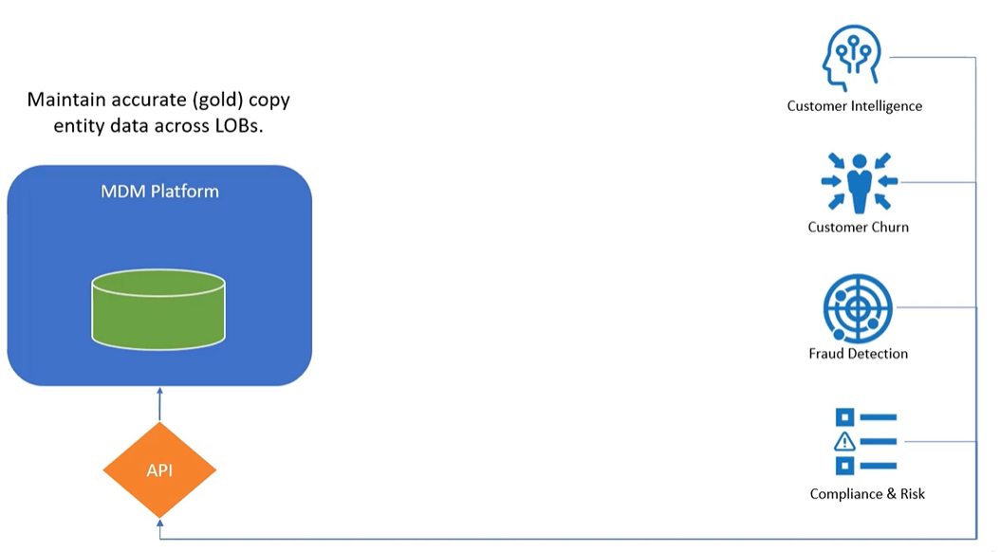
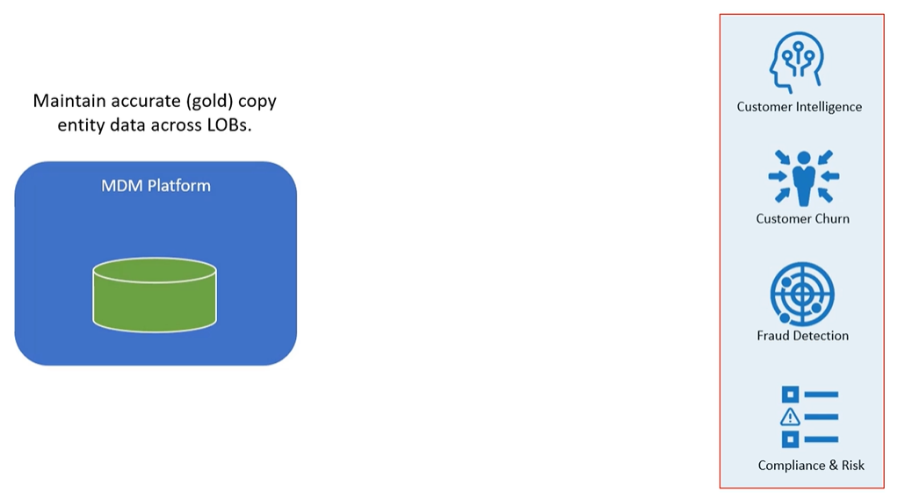
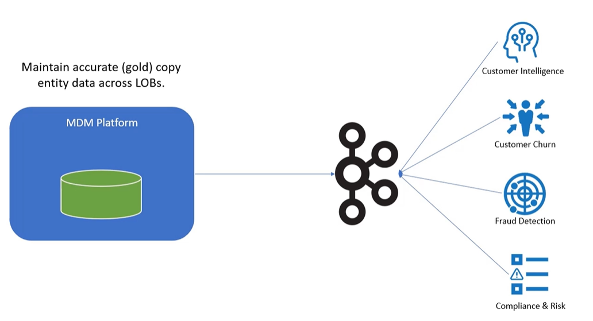
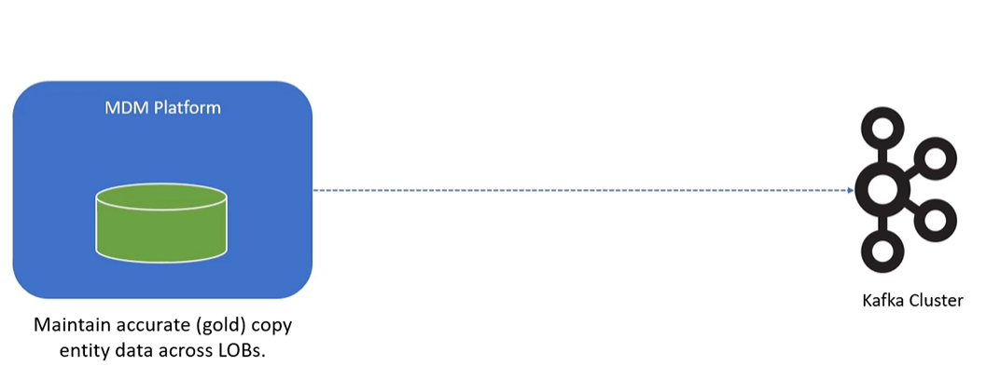
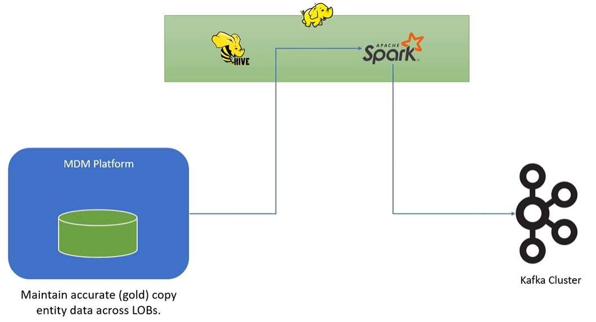
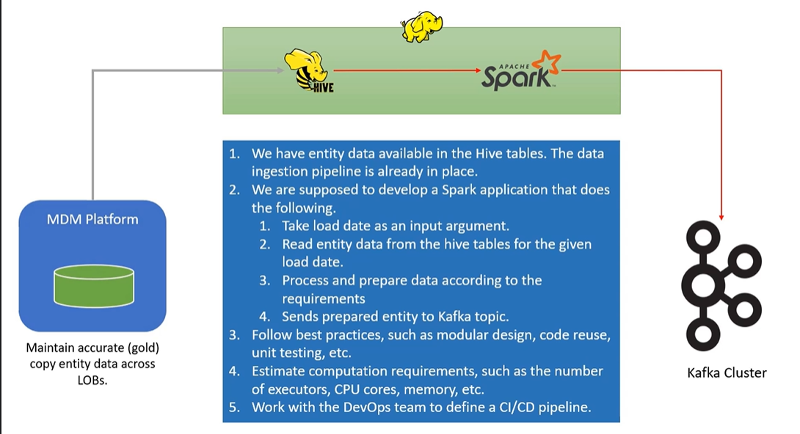
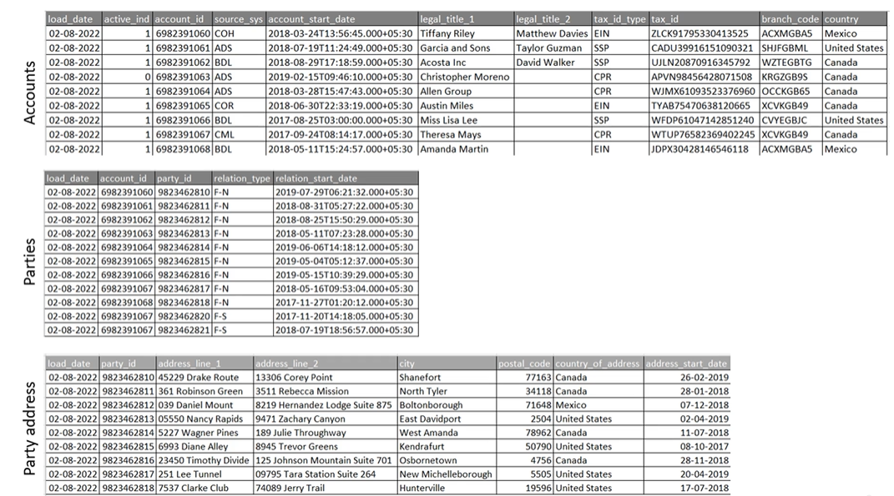

# Section 13 Capstone Project Notes

## Content
69. [Project Source Code and Resources](#69-project-source-code-and-resources)
70. [Project Scope and Background](#70-project-scope-and-background)
71. [Data Transformation Requirement](#71-data-transformation-requirement)
72. [Setup Your Starter Project](#72-setup-your-starter-project#)
73. [Test Your Started Project](#73-test-your-started-project)
74. [Setup Your Source Control and Process](#74-setup-your-source-control-and-process#)
75. [Create Youir Project CI  CD Pipeline](#75-create-youir-project-ci--cd-pipeline#)
76. [Develop Code](#76-develop-code)
77. [Write Test Cases](#77-write-test-cases)
78. [Working with Kafka integration](#78-working-with-kafka-integration)
79. [Estimating Resources for Your Application](#79-estimating-resources-for-your-application#)


filename.py

```python


```

Run the file
    terminal --> python filename.py

Result:


<br>
<br>


## 69. Project Source Code and Resources

[⬆ Back to content](#content)

### Project Source Code and Resources       
**Project Source Code**

All the project source code, data, and other resources are available in the resources of this lecture.

You can download the zip file for the following

1. SBDL - Starter       
2. SBDL     

Keep Learning and Keep Growing.


[⬆ Back to content](#content)


## 70. Project Scope and Background

[⬆ Back to content](#content)

Let's start with some project background. You are working for a large multinational bank. Your bank has a master data management platform. Let's call it an MDM platform. But what is an MDM platform? An MDM platform is basically a central data management platform.



<br>
<br>


The MDM platform is designed to synchronize master data within applications across the enterprise. It is critical to manage data that accurately represents business entities such as clients, employees, products, and facilities. An MDM platform does not record transactions. But they maintain an accurate gold copy of all the entities and facilities within the organization. The point is straight.

MDM provides a reliable repository for managing and sharing accurate entity data for all lines of business and different systems. 


<br>
<br>

The MDM system works in both ways. It collects data from different systems to keep itself up to date with all entity changes. It also shares data with other systems, so they use the true golden copy of the entities.


So we already have an MDM system in place. One side of the system collects data from almost every other system in the bank. You already have a data collection and management system in place. We are not going into the details of how that part of the MDM works. So here is the system in scope.

But how do these systems collect data from the MDM? Let's try to understand it.

The MDM system exposes some APIs for reading the most updated copy of the desired entity. 


<br>
<br>

So other systems in the bank will call the MDM API to query about an entity. For example, if you want to know the most up-to-date address of a customer, you can call an MDM API asking for the customer's address. And the MDM API will return the correct address entity for the given customer. All this works perfectly fine, and we are not going into the details of this portion of the system. However, many MDM consumer applications also maintain a copy of the entities. For example, let's assume a customer churn prediction system keeps a copy of the customer details, addresses, etc. 

Why do they keep a copy? Because they need to have a local copy of the data for creating BI reports and dashboards and generating predictions. These reports do not work reading data from the remote MDM system. The API interface is not a good solution for such requirements. The API system is in place, but it is not an excellent solution to fulfill our requirements. So let me remove the API also from the scope.


<br>
<br>

We have many downstream systems needing a copy of the MDM entities. So we have a new problem. How do we send the MDM entity data to these downstream systems? That's the problem we need to solve. We have an option to connect to the MDM system and ingest data downstream. But we have many such downstream systems. And we do not want all those systems to connect to the MDM and start copying data. That will be too much for the MDM system. I mean, so many systems connecting to the MDM platform and copying data from MDM will put a lot of workload on the MDM. This approach is not scalable. So how do we design it?

You decided to put a Kafka system in between these two ends. Once you have Kafka, we will bring entity data from MDM to Kafka. Then let these systems read from Kafka. This arrangement will make our system scalable without too much load on the MDM platform. We will bring data from MDM to Kafka once every day.


<br>
<br>

These systems can read the latest copy of the data from Kafka. Some might want to read it every day and synchronize their copies. Other systems might want to read from Kafka weekly and synchronize weekly. It depends on their requirement. In the worst case, the entity data will be outdated by a day. And that's your end-to-end data processing pipeline. If this pipeline works fine, you can increase the frequency to hourly. I mean, we are not creating a real-time data pipeline. It is a batch data flow pipeline that could be running weekly, daily, or even hourly depending upon the business requirements. 

You are assigned to the project to create the data pipeline between MDM and Kafka. I mean this project will bring data from the MDM platform, process and prepare it according to the given requirement and send it to the Kafka cluster. That is all for this capstone project. Consuming data from the Kafka topic and taking it to the downstream system is designed and developed by the downstream system team.


<br>
<br>

Now let's focus on this part and elaborate on the design details. We also have a Big data Hadoop cluster in the banking system. It is a dedicated Hadoop cluster, and you have some big data tools such as Hive and Spark already installed and configured in this platform. You are looking for opportunities to use the big data Hadoop cluster and PySpark to develop the MDM to Kafka pipeline. 


<br>
<br>

You started talking to the MDM team to understand how you can read data from the MDM platform using PySpark. MDM platform team gave you the following information. 

1. We have 500+ entities
2. MDM platform is already exporting all the entities to the Hadoop platform daily
3. It is a full data load every day
4. We export complete entity data daily and maintain 7 days of exports
5. The data export is available in Hive tables and is partitioned by the load_date
6. You can take the data for any load_date from the Hive tables and build your pipeline to Kafka

So here is the final situation. You already have a data ingestion pipeline in place. Data from MDM is being ingested into Hive tables. So your data ingestion problem is solved. All you need is to read data from Hive tables, process and prepare it according to your requirement and push it to Kafka. Looks like a small project. But it is a fairly complex project, and you will realize the complexities as we start detailing the requirements. But for now, let's define the high-level scope of the work. 


We have entity data available in the Hive tables. The data ingestion pipeline is already in place. We are supposed to develop a Spark application that does the following. Takes load_date as an input argument. Reads entity data from the hive tables for the given load date. Process and prepare data according to the requirements Sends prepared entity to Kafka topic. You must also follow all the standard best practices, such as modular design, code reuse, unit testing, etc. You are also given a task to estimate the computation requirement, such as the number of executors, CPU cores, memory, etc., and recommend the job configuration for smooth running. You also need to work with the DevOps team and help them define a CI/CD pipeline for this project.


<br>
<br>

That's all for the project scope and background. In the following lecture, we will discuss input data and transformation requirements.

[⬆ Back to content](#content)


## 71. Data Transformation Requirement

[⬆ Back to content](#content)

We talked about the high-level project requirement and scope in the earlier lecture. Here is the diagram:


<br>
<br>

Now let's talk about the data and the transformation requirements. You are asked to read the raw data about the entities and prepare it for sending to Kafka.

Let me explain the requirement for one entity. We have an account entity. The raw data for the account entity is exported into three hive tables. Here is the list of tables.

**Account Entity tables**       
- Account
- Parties
- Party Address

So, the account entity is made up of combining data from all three tables. Let me show you some sample records from all three tables. So we have some records in the account table, as shown here.


<br>
<br>

**Accounts table**
You have an active indicator, account id, account start date, legal title one and legal title two, etc. 

**Parties Table**
Each account is linked with one or more parties. You can see the account id and party id in the parties table. The party id is the primary key of the parties table, and the account id is a foreign key from the account table. One account may have one or more parties associated with it. 

**Party Address Table**
Similarly, each party may have an address. Simple.

These three tables are for one entity. We have a few hundred entities, so the complete project for moving all entities is an enormous requirement. But for our purpose, we will work for one entity, and the same approach is applied to other entities in the bank.

We have three tables, and we need to read all three tables, combine data for each account and create one entity record. In this example, we have ten unique account ids. So the end result should send ten account entity records to the Kafka topic. Each entity record combines account information, associated parties, and addresses. 

Now let me show you one final record. Here it is. 

```json
{
    "eventHeader": {
        "eventIdentifier": "38d57237-a566-4ec4-a471-f659e9ce8437",
        "eventType": "SBDL-Contract",
        "majorSchemaVersion": 1,
        "minorSchemaVersion": 0,
        "eventDateTime": "2022-09-06T20:49:03+0530"
    },
    "keys": [
        {
            "keyField": "contractIdentifier",
            "keyValue": "6982391067"
        }
    ],
    "payload": {
        "contractIdentifier": {
            "operation": "INSERT",
            "newValue": "6982391067"
        },
        "sourceSystemIdentifier": {
            "operation": "INSERT",
            "newValue": "BDL"
        },
        "contactStartDateTime": {
            "operation": "INSERT",
            "newValue": "2018-08-29T17:18:59.000+05:30"
        },
        "contractTitle": {
            "operation": "INSERT",
            "newValue": [
                {
                    "contractTitleLineType": "lgl_ttl_ln_1",
                    "contractTitleLine": "Acosta Inc"
                },
                {
                    "contractTitleLineType": "lgl_ttl_ln_2",
                    "contractTitleLine": "David Walker"
                }
            ]
        },
        "taxIdentifier": {
            "operation": "INSERT",
            "newValue": {
                "taxIdType": "SSP",
                "taxId": "UJLN20870916345792"
            }
        },
        "contractBranchCode": {
            "operation": "INSERT",
            "newValue": "WZTEGBTG"
        },
        "contractCountry": {
            "operation": "INSERT",
            "newValue": "Canada"
        },
        "partyRelations": [
            {
                "partyIdentifier": {
                    "operation": "INSERT",
                    "newValue": "9823462817"
                },
                "partyRelationshipType": {
                    "operation": "INSERT",
                    "newValue": "F-N"
                },
                "partyRelationStartDateTime": {
                    "operation": "INSERT",
                    "newValue": "2018-05-16T09:53:04.000+05:30"
                },
                "partyAddress": {
                    "operation": "INSERT",
                    "newValue": {
                        "addressLine1": "251 Lee Tunnel",
                        "addressLine2": "09795 Tara Station Suite 264",
                        "addressCity": "New Michelleborough",
                        "addressPostalCode": "05505",
                        "addressCountry": "United States",
                        "addressStartDate": "2019-04-20"
                    }
                }
            },
            {
                "partyIdentifier": {
                    "operation": "INSERT",
                    "newValue": "9823462820"
                },
                "partyRelationshipType": {
                    "operation": "INSERT",
                    "newValue": "F-S"
                },
                "partyRelationStartDateTime": {
                    "operation": "INSERT",
                    "newValue": "2017-11-20T14:18:05.000+05:30"
                }
            },
            {
                "partyIdentifier": {
                    "operation": "INSERT",
                    "newValue": "9823462821"
                },
                "partyRelationshipType": {
                    "operation": "INSERT",
                    "newValue": "F-S"
                },
                "partyRelationStartDateTime": {
                    "operation": "INSERT",
                    "newValue": "2018-07-19T18:56:57.000+05:30"
                }
            }
        ]
    }
}
```

I opened one sample output record in the Visual Studio Code. The final output to Kafka must be a JSON record. Everything is collapsed, so you can see the top-level structure of the JSON message. We have three top-level fields in the JSON message. Event Header, Keys and Payload. The JSON message is a generic structure that is being followed for all the entities. We are working on the account entity. So let's see how account entity data fits into this JSON message structure. Let me explain the event header.

So the event header has got five items:     
- eventIdentifier is a UUID for each record. You are asked to dynamically generate it for each entity.
- eventType is a fixed string. For the account entity, it will be SBDL-Contrat, as shown here.
- majorSchemaVersion and minorSchemaVersion, which are also fixed numbers.
- eventDateTime is the timestamp.

This was when the event was generated for sending it to Kafka.

So basically, it is a current system timestamp.

Now let me collapse the header and expand the keys.

The key is a JSON Array.

You can see the entity symbol here.

Each element of the key is a struct of two fields.

key field name

and keyValue

We have a single key field for the account entity.

The value shown here is the account id.

The key field name is contractIdentifier.

But that's nothing but account_id.

In the banking system, you are told to represent an account as a contract.

So the account_id is sent as contractIdentifier.

The key is an array.

In our case, we have only one primary key field, so you will see only one element in the array.

But some other entities may have composite keys.

And they will be sending all the composite key fields in this array.

But for the account entity, it is as simple as a single key field.

That's all about the keys.

The last one is the payload.

And that's the actual data.

Let me collapse the key and expand the payload.

Great!

So we have eight fields in the payload.

The contractIdentifier is the account_id.

Let me expand it and show you.

So, each field goes as a set of three values.

operation

oldValue

and newValue

In the case of the INSERT operation, the old value is null, and hence it is not shown here.

For our requirement, everything is an INSERT operation.

We are not implementing the UPDATE operation in this phase.

But in future phases, we will implement the UPDATE operation, so the JSON message is designed like this.

The point is straight.

Each field goes as a set of three values.

operation

oldValue

and newValue

For the current project, the operation type is always INSERT.

The oldValue is always null and should not appear in the JSON message.

The newValue is the field value from the table.

Make sense?

Great!

Let's look at the next one.

Let's look at the next one.

The contactStartDateTime is the account_start_date field from the accounts table.

And you can see the values here.

I hope it makes sense now.

Right?

Most fields will be sent as a triplet of three values: operation, oldValue, and newValue.

In our case, the operation is always INSERT, and the oldValue is NULL.

Make sense?

Great!

But some fields are combined and have different rules.

Let's look at the contractTitle.

Let me collapse all other fields and show you only the contract title.

Here it is.

So the contract title is an array of all the legal titles from the account table.

You can see it here.

Let me show you the sample data.

Here it is.

Look at the third record.

Acosta Inc is the legal title one, and David walker is the legal title two.

Now come back to the JSON message.

Both legal titles are combined and sent into an array of legal titles.

So this is another complexity.

The rest of the fields are simple,

and you can easily understand the mapping from the account table to the JSON message.

Now let's come to the partyRelations.

The partyRelations is an array of all the parties and their address.

This account has got three associated parties.

So you will see three parties in the partyRelations array.

The address is also embedded inside the party record.

Let me show you the first party.

Here it is.

So we have partyIdentifier, partyRelationshipType, partyRelationStartDateTime and the partyAddress.

And that's all about the data and the transformation.

You have three input tables.

You can download the sample data files for those three input tables.

I also showed you one output JSON sample.

You can download the sample JSON output.

I recommend you download all these data files

and look at the input and output samples to understand the mapping and transformation requirements.

In the actual project also, you will be given requirements in the same way.

You will get the input and the desired output.

Then you are supposed to work out the transformation logic to achieve it.


[⬆ Back to content](#content)


## 72. Setup Your Starter Project


[⬆ Back to content](#content)

### Subheader


[⬆ Back to content](#content)


## 73. Test Your Started Project

[⬆ Back to content](#content)

### Subheader


[⬆ Back to content](#content)


## 74. Setup Your Source Control and Process


[⬆ Back to content](#content)

### Subheader


[⬆ Back to content](#content)


## 75. Create Youir Project CI  CD Pipeline

[⬆ Back to content](#content)

### Subheader


[⬆ Back to content](#content)


## 76. Develop Code

[⬆ Back to content](#content)

### Subheader


[⬆ Back to content](#content)


## 77. Write Test Cases

[⬆ Back to content](#content)

### Subheader


[⬆ Back to content](#content)


## 78. Working with Kafka integration

[⬆ Back to content](#content)

### Subheader


[⬆ Back to content](#content)


## 79. Estimating Resources for Your Application

[⬆ Back to content](#content)

### Subheader


[⬆ Back to content](#content)


